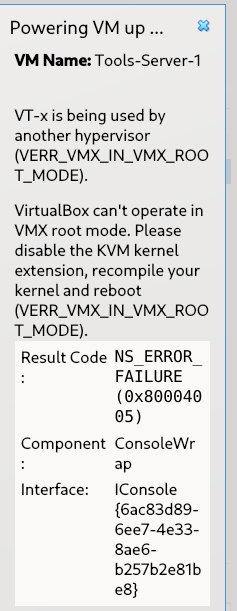
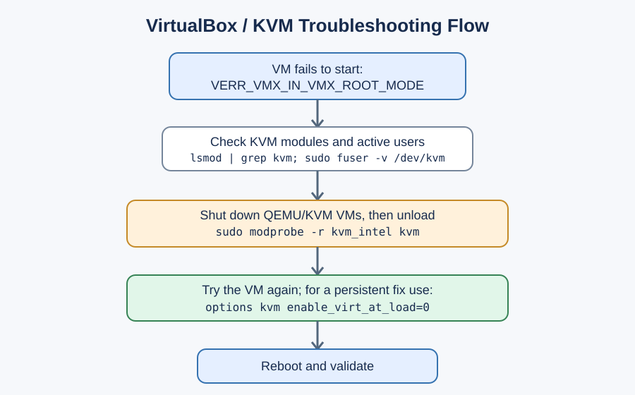

# Fix VirtualBox “VERR_VMX_IN_VMX_ROOT_MODE” on Debian 13

**Illustrated troubleshooting and recovery guide**  
**Platform:** Debian 13 (Linux host), VirtualBox, optionally Vagrant  
**Example VM:** `Tools-Server-1`  
**Last reviewed:** October 22, 2026

> **Applies to:** Intel hosts showing `VERR_VMX_IN_VMX_ROOT_MODE`. The analogous AMD error is often `VERR_SVM_IN_USE`; replace `kvm_intel` with `kvm_amd` where appropriate.
>
> **Safety first:** Shut down running QEMU/KVM virtual machines before unloading KVM modules. Avoid permanently blacklisting KVM if you use QEMU, libvirt, or other KVM-dependent tools.

## 1. Identify the error



**Figure 1.** The original error displayed when starting `Tools-Server-1`.

Typical message:

```text
VT-x is being used by another hypervisor (VERR_VMX_IN_VMX_ROOT_MODE).
VirtualBox can't operate in VMX root mode.
Result Code: NS_ERROR_FAILURE (0x80004005)
Component: ConsoleWrap
```

### What causes it?

On some Linux hosts, the KVM hypervisor reserves CPU hardware-virtualization facilities before VirtualBox can use them. Starting with Linux kernel 6.12, KVM normally initializes hardware virtualization when its modules load. Consequently, VirtualBox may report this conflict even when no KVM guest is actively running. This diagnosis is **likely**, but it should be confirmed using the checks below.

**Do not interpret the error as proof that VT-x is disabled in BIOS.** The message specifically indicates that another hypervisor is using it.

## 2. Troubleshooting decision flow



**Figure 2.** Diagnose the conflict, apply a temporary fix, and then select a reversible persistent fix.

## 3. Inspect the host (no system changes)

Open a terminal on the Debian **host**, not inside a guest VM.

### Step 3.1 — Check the kernel, CPU, and VirtualBox version

```bash
uname -r
lscpu | grep -E 'Vendor ID|Virtualization'
VBoxManage --version
```

You might see a Debian 13 kernel in the `6.12.x` series and `VT-x` for an Intel processor. Your actual output can differ.

### Step 3.2 — Check loaded KVM modules

```bash
lsmod | grep -E '^(kvm|kvm_intel|kvm_amd)\b'
```

Example (illustrative):

```text
kvm_intel  446464  0
kvm       1454080  1 kvm_intel
```

Loaded modules support the KVM-conflict diagnosis but **do not by themselves prove** that KVM currently owns VT-x. The active parameter and the result of a controlled test also matter.

### Step 3.3 — Check whether KVM is in use

```bash
sudo fuser -v /dev/kvm
ps aux | grep -Ei '[q]emu|[k]vm|[v]irtualbox|[v]box'
```

If `/dev/kvm` does not exist, `fuser` may report that the path is unavailable; that is not automatically a problem.

### Step 3.4 — Inspect the KVM initialization setting

```bash
cat /sys/module/kvm/parameters/enable_virt_at_load 2>/dev/null || echo 'KVM module/parameter not available'
```

A value of `Y` means KVM is configured to enable hardware virtualization when its module loads; `N` means it is not. If the parameter is unavailable, do not infer its state.

Check for existing distribution configuration before adding another file:

```bash
grep -RnsE 'enable_virt_at_load|blacklist kvm' /etc/modprobe.d /usr/lib/modprobe.d 2>/dev/null
```

Some Debian VirtualBox packages already ship a suitable KVM configuration. If an appropriate setting already exists, investigate why it is not taking effect before creating a duplicate.

## 4. Temporary fix — test without rebooting

1. Shut down all QEMU/KVM guests and other software using `/dev/kvm`.
2. Close the failed VirtualBox startup dialog.
3. On an **Intel** host, run:

```bash
sudo modprobe -r kvm_intel kvm
```

On an **AMD** host, use:

```bash
sudo modprobe -r kvm_amd kvm
```

4. Confirm the relevant modules are absent:

```bash
lsmod | grep -E '^(kvm|kvm_intel|kvm_amd)\b' || echo 'No KVM modules loaded'
```

5. Launch VirtualBox and start `Tools-Server-1` again. For a Vagrant-managed VM, use the appropriate project directory and VM name, for example:

```bash
vagrant up Tools-Server-1 --provider=virtualbox
```

> **Important:** The Vagrant command only applies if the name in your `Vagrantfile` is exactly `Tools-Server-1`. The name visible in the VirtualBox GUI may differ from the Vagrant machine identifier. Use `vagrant status` to verify.

**Expected result:** If the guest now starts, the KVM/VirtualBox ownership conflict is strongly indicated. This temporary fix typically needs repeating after KVM modules are loaded again.

**If the command reports “module is in use”:** Do not force-unload the modules. Re-run `sudo fuser -v /dev/kvm`, stop the dependent guests/services gracefully, and retry.

## 5. Preferred persistent fix — keep KVM available

This approach changes *when* KVM takes ownership of hardware virtualization, rather than disabling KVM entirely. It is generally preferable on a workstation that also uses QEMU/KVM.

### Step 5.1 — Check whether the setting is already installed

```bash
grep -Rns 'enable_virt_at_load' /etc/modprobe.d /usr/lib/modprobe.d 2>/dev/null
```

If you already see an effective `options kvm enable_virt_at_load=0`, skip to verification and investigate package/kernel configuration if the conflict remains.

### Step 5.2 — Create a local modprobe configuration

```bash
sudo nano /etc/modprobe.d/kvm-virtualbox-compat.conf
```

Add this single line:

```conf
options kvm enable_virt_at_load=0
```

Save with **Ctrl+O**, **Enter**, then exit with **Ctrl+X**.

### Step 5.3 — Update initramfs and reboot

```bash
sudo update-initramfs -u
sudo reboot
```

Updating initramfs helps ensure the option is available when KVM modules are loaded early during boot. The reboot is required for a reliable fresh test.

### Step 5.4 — Verify

After reboot:

```bash
cat /sys/module/kvm/parameters/enable_virt_at_load 2>/dev/null
```

When the `kvm` module is loaded and the setting took effect, the expected value is:

```text
N
```

If KVM is not loaded, first check `lsmod | grep kvm`; an absent parameter is not equivalent to `N`.

Then retry starting the VirtualBox VM. If the VM works while KVM modules are loaded, the persistent fix has succeeded for this workload. Simultaneously running guests from different hypervisors may still have compatibility or resource constraints; test your actual workflow.

## 6. Alternative persistent fix — kernel boot parameter

If the modprobe configuration does not take effect, another documented workaround is the kernel command-line parameter:

```text
kvm.enable_virt_at_load=0
```

Before editing GRUB, back up its configuration:

```bash
sudo cp /etc/default/grub /etc/default/grub.backup-before-kvm-fix
sudo nano /etc/default/grub
```

Append `kvm.enable_virt_at_load=0` **inside the existing quotes** in `GRUB_CMDLINE_LINUX_DEFAULT`, without removing existing boot options. For example, only if your original setting was `quiet`:

```conf
GRUB_CMDLINE_LINUX_DEFAULT="quiet kvm.enable_virt_at_load=0"
```

Apply and reboot:

```bash
sudo update-grub
sudo reboot
```

After reboot, verify:

```bash
cat /proc/cmdline
cat /sys/module/kvm/parameters/enable_virt_at_load 2>/dev/null
```

**Use either the modprobe configuration or the GRUB workaround first;** there is usually no reason to configure both. GRUB edits carry boot-configuration risk, so prefer Section 5 when possible.

## 7. Last resort — disable automatic KVM loading

**Not recommended if you use QEMU, libvirt, or other KVM-based tooling.** Only consider blacklisting KVM when you intentionally do not need it and the less disruptive solutions fail. Blacklisting is not the default recommendation in this guide.

Example for an Intel-only VirtualBox host:

```bash
sudo nano /etc/modprobe.d/blacklist-kvm-virtualbox.conf
```

```conf
blacklist kvm_intel
blacklist kvm
```

A blacklist prevents common alias-based automatic loading; it is **not** a guarantee that an explicit module load cannot occur. If applying this strategy, test your environment and record the change for future maintenance.

```bash
sudo update-initramfs -u
sudo reboot
```

Check `lsmod | grep kvm`. If modules still load, identify which service explicitly requested them rather than adding increasingly aggressive blocks without understanding the dependency.

## 8. Rollback instructions

If you used **Section 5**:

```bash
sudo rm /etc/modprobe.d/kvm-virtualbox-compat.conf
sudo update-initramfs -u
sudo reboot
```

If you used **Section 6**, carefully remove only `kvm.enable_virt_at_load=0` from the relevant `GRUB_CMDLINE_LINUX_DEFAULT` value, then:

```bash
sudo update-grub
sudo reboot
```

If you used **Section 7**:

```bash
sudo rm /etc/modprobe.d/blacklist-kvm-virtualbox.conf
sudo update-initramfs -u
sudo reboot
```

Only remove files that **you actually created** using this guide. Never delete unrelated distribution-provided configuration.

## 9. Diagnostic bundle for further investigation

Run the following if VirtualBox still fails:

```bash
printf '\n=== KERNEL ===\n'; uname -r
printf '\n=== CPU ===\n'; lscpu | grep -E 'Vendor ID|Virtualization'
printf '\n=== KVM MODULES ===\n'; lsmod | grep -E '^(kvm|kvm_intel|kvm_amd)\b' || true
printf '\n=== VIRTUALBOX MODULES ===\n'; lsmod | grep '^vbox' || true
printf '\n=== KVM PARAMETER ===\n'; cat /sys/module/kvm/parameters/enable_virt_at_load 2>/dev/null || true
printf '\n=== CONFIGURATION ===\n'; grep -Rns 'enable_virt_at_load' /etc/modprobe.d /usr/lib/modprobe.d 2>/dev/null || true
printf '\n=== KVM USERS ===\n'; sudo fuser -v /dev/kvm 2>&1 || true
printf '\n=== VIRTUALBOX VERSION ===\n'; VBoxManage --version
printf '\n=== BOOT ARGUMENTS ===\n'; cat /proc/cmdline
```

If the KVM parameter is `N` and VirtualBox still fails, also investigate VirtualBox host modules, version compatibility, BIOS virtualization settings, Secure Boot module-signing errors, and the VM's `VBox.log`. These are **alternative diagnostic branches**, not established causes of the screenshot error.

## 10. Quick comparison

| Approach | Reboot? | KVM availability | Best use |
|---|---|---|---|
| Unload KVM modules | No, if modules unused | Temporarily unavailable | Fast diagnosis |
| `options kvm enable_virt_at_load=0` | Yes, for reliable application | Generally retained | **Preferred persistent fix** |
| GRUB `kvm.enable_virt_at_load=0` | Yes | Generally retained | When modprobe settings do not apply |
| Blacklist KVM | Yes | May disrupt KVM-dependent tools | VirtualBox-only systems, last resort |

## 11. Sources and technical verification

1. **Debian Wiki — VirtualBox** (specific section on `VERR_VMX_IN_VMX_ROOT_MODE`): https://wiki.debian.org/VirtualBox/
2. **Debian Bug #1082157 — VirtualBox does not start VMs with Linux 6.12:** https://bugs.debian.org/cgi-bin/bugreport.cgi?bug=1082157
3. **Debian Bug #1091650 — VirtualBox cannot start with Linux 6.12.6:** https://bugs.debian.org/cgi-bin/bugreport.cgi?bug=1091650
4. **VirtualBox GitHub issue #141 — Linux 6.12+ KVM conflict:** https://github.com/VirtualBox/virtualbox/issues/141
5. **VirtualBox GitHub issue #188 — `enable_virt_at_load=0` workaround and packaging:** https://github.com/VirtualBox/virtualbox/issues/188

## Quality and limitations check

- **Evidence level:** High that this exact error commonly reflects KVM/VirtualBox contention on affected Linux kernels; the particular host has **not** yet been diagnosed through command output.
- **Assumptions:** Debian 13 runs directly on the physical host; the screenshot is from its VirtualBox instance; the CPU is likely Intel based on `VT-x` and `VMX` terminology.
- **Unresolved:** Exact kernel build, VirtualBox package/version, loaded module state, and whether QEMU/libvirt are in active use.
- **Verification:** The decisive test is whether the VM starts after safely unloading KVM or after setting `enable_virt_at_load=0` and rebooting.
